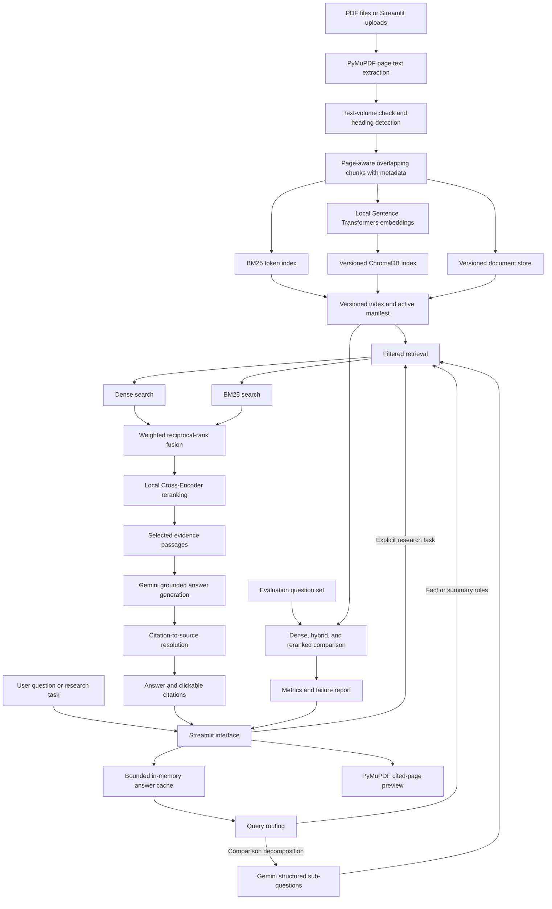

# ResearchPaper AI: Technical Demo

## 1. Project Overview

ResearchPaper AI is a local-first research assistant for exploring academic PDFs.
Researchers often need to locate a method, result, limitation, or relationship
across a collection of papers; reading each document manually or asking a general
chatbot can be slow and may produce answers without verifiable sources.

The application uses retrieval-augmented generation (RAG): it first searches
indexed passages from the user's papers, then asks Google Gemini to answer from
those passages. The response includes paper-and-page citations that can be opened
in a PDF preview. This grounding helps users trace an answer back to the source;
it does not guarantee that every generated claim is correct.

## 2. Key Features

- **PDF ingestion:** Upload PDFs into collections in the Streamlit interface, or
  place them under `data/pdfs/`. PyMuPDF extracts text page by page. Documents
  with little extractable text are logged and skipped; OCR is not currently run.
- **Chunking and metadata:** Text is split into overlapping chunks that retain
  source path, title, page, collection, section, and chunk-offset metadata.
  Context headers add paper, section, and page information to each chunk.
- **Semantic and keyword search:** Local Sentence Transformers embeddings power
  dense search in ChromaDB. BM25 provides lexical search for exact terms,
  acronyms, and dataset names.
- **Hybrid retrieval and reranking:** The dense and BM25 result lists are
  combined with weighted reciprocal-rank fusion. Collection and paper filters
  can narrow the search. A local Cross-Encoder reranks candidates before answer
  generation.
- **Query routing:** Obvious fact and summary questions are routed with local
  rules. Comparison questions use Gemini structured output to create focused
  sub-questions; the resulting passages are merged and reranked. The interface
  also offers explicit Summary, Contributions, Limitations, and Compare
  methodologies tasks.
- **Grounded answers and citations:** Gemini generates answers from retrieved
  context with instructions to cite factual claims. Citation tags are resolved
  against the retrieved paper/page metadata before they become clickable source
  controls in the interface.
- **PDF page previews:** Selecting a citation renders the corresponding source
  page and highlights the cited passage when it can be located in the PDF.
- **Library management:** Create collections, upload and remove PDFs, and review
  per-document indexing status. Uploads and removals trigger an index rebuild.
- **Evaluation dashboard:** The evaluation script compares dense-only,
  hybrid-only, and hybrid-plus-reranking retrieval. It reports retrieval
  metrics, latency, failures, and—when enabled—answer-quality and citation
  metrics.

## 3. Technology Stack

| Technology | Role in the project |
|---|---|
| **Python** | Implements ingestion, indexing, retrieval, evaluation, and application logic. |
| **LangChain** | Supplies document and text-splitting abstractions, retrievers, and model integrations. |
| **Google Gemini** | Generates grounded responses, decomposes comparison queries, and optionally judges answer quality. |
| **Sentence Transformers** | Provides the local `sentence-transformers/all-MiniLM-L6-v2` embedding model and Cross-Encoder support. |
| **ChromaDB** | Stores vectors and supports dense similarity search with metadata filters. |
| **BM25 (`rank_bm25`)** | Retrieves passages by lexical relevance, complementing semantic search. |
| **Cross-Encoder** | `cross-encoder/ms-marco-MiniLM-L-6-v2` jointly scores each query/passage pair to rerank retrieved candidates. |
| **PyMuPDF** | Extracts page text and renders cited pages, including passage highlighting. |
| **Streamlit** | Provides the research chat, PDF library controls, citation preview, and dashboard. |
| **SQLite** | Stores the local collection catalog, document records, and indexing status. |

## 4. Architecture and Workflow

The indexing and question-answering paths share page and collection metadata. The
vector index, BM25 index, and document store are built as a version; an active
manifest is switched only after a successful build. Routine routing and retrieval
run locally, while Gemini is used for answer generation and comparison
decomposition.



By default, retrieval combines dense and BM25 rankings with weights of 0.6 and
0.4, considers up to 20 candidates, and passes up to 8 reranked passages to
generation; these values are configurable. Paper-level summaries use a wider
retrieval pool. The answer cache is process-local, bounded, and keyed by the
active index version/revision and request settings so a newly activated index
does not reuse answers from the prior one.

## 5. Project Structure

```text
.
├── app.py                  # Streamlit research interface and dashboard
├── config.py               # Environment settings, paths, models, and RAG defaults
├── requirements.txt        # Python dependencies
├── .streamlit/config.toml   # Light and dark themes
├── assets/                 # ResearchPaper AI SVG wordmark and icon
├── src/
│   ├── ingestion.py        # PDF extraction, filtering, metadata, and chunking
│   ├── indexing.py         # Embeddings, Chroma, BM25, and version manifests
│   ├── library.py          # SQLite catalog, collections, and index status
│   ├── retrieval.py        # Hybrid search, filters, and reranking
│   ├── router.py           # Local intent rules and comparison decomposition
│   ├── generation.py       # Gemini prompts, citations, and answer-quality scoring
│   └── pipeline.py         # Cache and orchestration of routing through generation
├── scripts/
│   ├── build_index.py      # Rebuild the library index
│   └── evaluate.py         # Retrieval and optional answer-quality evaluation
├── eval/
│   └── sample_qa.json      # 65-question evaluation set
├── tests/                  # Focused unit and integration tests
└── data/                   # Local PDFs, SQLite catalog, and generated indexes
```

`data/` and evaluation results are local runtime data, not source-controlled
corpus files. The app creates a local SQLite catalog and versioned index files
when it runs or builds an index.

## 6. Installation and Execution

The following commands use Windows PowerShell and Python 3.12 (the project
documents support for Python 3.10–3.12):

```powershell
git clone https://github.com/Misiker101/academic-rag-assistant.git
Set-Location .\academic-rag-assistant

py -3.12 -m venv .venv
.\.venv\Scripts\Activate.ps1
python -m pip install --upgrade pip
python -m pip install -r .\requirements.txt
```

Create the local environment file if it does not exist, then open it in a text
editor. Enter the Gemini key locally; do not put a real key in a command, source
file, screenshot, or Git commit. `.env` is ignored by Git.

```powershell
if (-not (Test-Path .\.env)) {
    New-Item -ItemType File -Path .\.env | Out-Null
}
notepad .\.env
```

Add the following to `.env`, replacing the placeholder in the editor. The model
setting is optional; the application also has a default.

```text
GOOGLE_API_KEY=<your Gemini API key>
GEMINI_MODEL=gemini-3.5-flash
```

To index PDFs already in the default collection, copy them into `data\pdfs\` and
build the indexes. Alternatively, upload them through the app; that workflow
rebuilds the index automatically.

```powershell
New-Item -ItemType Directory -Force .\data\pdfs | Out-Null
Copy-Item "C:\path\to\papers\*.pdf" .\data\pdfs\
python .\scripts\build_index.py
python -m streamlit run .\app.py
```

The first index build downloads the configured embedding and reranker models if
they are not cached locally. Scanned/image-only PDFs are reported in
`data\skipped_pdfs.json`; OCR is not performed by this project. Gemini quota is
provider- and model-dependent, and quota-exhausted requests are not automatically
retried.

## 7. Demo Examples

Select **Research** in the sidebar. For paper-specific tasks, choose the paper
from **Target papers**; for methodology comparisons, select at least two papers.

| Task | Example question |
|---|---|
| **Summary** | “Summarize the problem, approach, main findings, and conclusion of this paper.” |
| **Contributions** | “What contributions does *[paper title]* explicitly claim?” |
| **Factual question** | “Which dataset and evaluation metric did *[paper title]* use?” |
| **Limitations** | “What limitations do the authors state? Separate explicit limitations from any inference.” |
| **Compare methodologies** | “Compare the selected papers’ methods, datasets, evaluation protocols, and stated trade-offs.” |

After an answer, select a `[Paper title, p. N]` citation to inspect the cited
page and highlighted snippet. The exact answers depend on which PDFs are in the
active collection and what text their PDFs expose.

## 8. Limitations and Future Improvements

### Current limitations

- **PDF text quality:** The application extracts text with PyMuPDF and skips
  documents where too many pages contain little extractable text. OCR, table
  reconstruction, and specialized equation parsing are not implemented.
- **Hosted model dependency:** Gemini is required for answer generation and
  comparison decomposition. Requests may be constrained by the configured
  project's quota; automatic retries are disabled.
- **Evaluation scope:** The included 65-question set is a fixed, project-specific
  benchmark. Its results are meaningful only when the expected papers are
  present in the indexed corpus. Token usage is not collected. The optional
  answer-quality mode uses Gemini as a judge, so it makes additional API calls.
- **Session persistence and deployment:** Chat messages and answer cache are
  held in the active Streamlit process/session. The project does not provide
  persistent conversation history, user authentication, or a multi-user service
  API.

### Proposed improvements (not currently implemented)

- **Expand document ingestion:** Basic PDF upload, removal, and collections are
  already implemented. Future work could add asynchronous/background indexing,
  OCR for scanned documents, richer table handling, cloud object storage, and
  clearer large-file progress and recovery.
- **Persist conversation history:** Add user-aware sessions and durable history
  with explicit retention and deletion controls.
- **Strengthen evaluation:** Grow the question set across more papers and query
  types; add repeatable corpus fixtures, citation-page validation, error
  analysis, and confidence intervals. Existing dense/hybrid/reranked retrieval
  metrics and optional answer-quality scoring provide a starting point.
- **Add a service layer:** Expose the pipeline through FastAPI with typed
  request/response contracts, authentication, and background jobs.
- **Package and deploy:** Add Docker images and reproducible model setup, then
  deploy with managed storage, secure secret management, observability, and
  quota-aware scaling. Docker and cloud deployment are not part of the current
  implementation.

## 9. Conclusion

ResearchPaper AI demonstrates an end-to-end RAG application for academic
literature: page-aware ingestion, metadata-rich chunking, dense and lexical
retrieval, rank fusion, reranking, grounded generation, and source-linked
verification. Its evaluation tooling makes retrieval strategies and failure
cases inspectable, while the Streamlit application turns the pipeline into a
usable paper library and research assistant. The project is a practical
portfolio example of combining retrieval, language models, evaluation, and
user-facing source transparency without claiming benchmark performance that
has not been measured on the target corpus.
