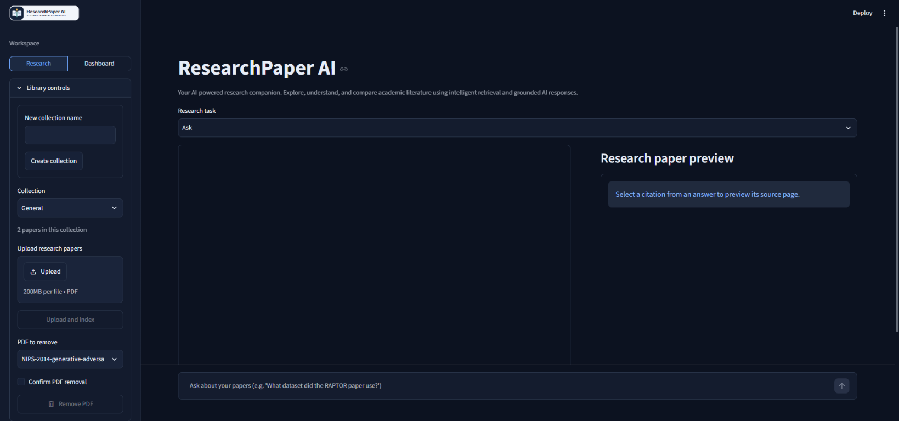
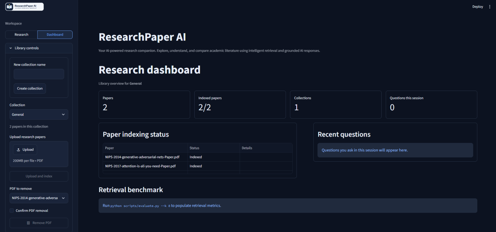
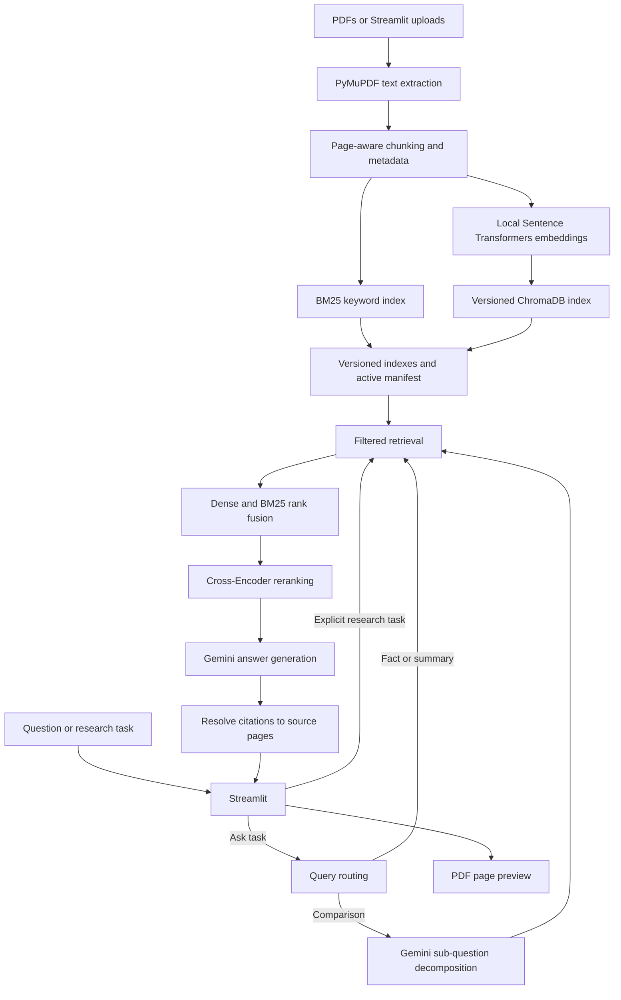

# ResearchPaper AI

ResearchPaper AI is a local-first **retrieval-augmented generation (RAG)**
assistant for academic PDF collections. Ask questions about your papers and get
answers grounded in retrieved passages, with clickable paper-and-page citations
and a preview of the cited PDF page.

The project demonstrates document ingestion, dense and keyword retrieval,
reciprocal-rank fusion, reranking, query routing, grounded generation, and
retrieval evaluation. For the technical walkthrough, see
[DEMO.md](DEMO.md).

| Component | Technology |
|---|---|
| Language and application | Python, Streamlit |
| LLM | Google Gemini, configurable with `GEMINI_MODEL` |
| Embeddings | `sentence-transformers/all-MiniLM-L6-v2` |
| Vector search | ChromaDB |
| Keyword search | BM25 (`rank_bm25`) |
| Reranking | `cross-encoder/ms-marco-MiniLM-L-6-v2` |
| PDF processing | PyMuPDF |
| Local catalog | SQLite |

---

## Table of contents

1. [Features](#features)
2. [Screenshots](#screenshots)
3. [Architecture](#architecture)
4. [Project structure](#project-structure)
5. [Quick start](#quick-start)
6. [Document management](#document-management)
7. [Research assistant](#research-assistant)
8. [Research dashboard](#research-dashboard)
9. [RAG evaluation](#rag-evaluation)
10. [Limitations and next steps](#limitations-and-next-steps)
11. [Tests](#tests)
12. [RAG concepts](#rag-concepts)
13. [License](#license)

---

## Features

- Upload, remove, and organize PDFs in collections; review indexing status.
- Extract page text, add paper/section/page context, and split it into
  overlapping chunks with source metadata.
- Combine ChromaDB semantic search and BM25 keyword search using weighted
  reciprocal-rank fusion; filter by collection and paper.
- Rerank candidate passages with a local Cross-Encoder.
- In **Ask** mode, route routine fact and summary questions locally; use Gemini
  to decompose comparison questions.
- Ask for answers, summaries, contributions, limitations, and methodology
  comparisons. Answers are generated from retrieved passages and expose
  citations that match retrieved paper/page metadata.
- Open a cited PDF page in the interface and highlight the matching passage
  when it can be located.
- Compare dense, hybrid, and reranked retrieval with the evaluation script and
  display the report in the research dashboard.

## Screenshots

### Research workspace

The research workspace brings paper collection management, research tasks, the
question interface, and the PDF preview together in one view.



### Research dashboard

The dashboard summarizes the selected collection, shows paper indexing status
and recent questions, and provides a place to review retrieval benchmark results.



## Architecture



By default, retrieval fuses dense and BM25 rankings with weights of 0.6 and 0.4,
selects from up to 20 candidates, and sends up to 8 reranked chunks to answer
generation. These settings are configurable. Index rebuilds create a new
version and switch the active manifest only after a successful build.

## Project structure

```
ResearchPaper-AI-v01/
├── app.py                  # Streamlit interface, research tasks, and dashboard
├── .streamlit/
│   └── config.toml         # Light and dark themes
├── assets/
│   ├── researchpaper-ai-logo.svg
│   └── researchpaper-ai-mark.svg
├── config.py               # Environment settings and model/retrieval defaults
├── requirements.txt        # Python dependencies
├── DEMO.md                 # Technical portfolio and demo walkthrough
├── src/
│   ├── ingestion.py        # PDF extraction, filtering, metadata, and chunking
│   ├── indexing.py         # Embeddings, Chroma, BM25, and version manifests
│   ├── library.py          # SQLite catalog, collections, and index status
│   ├── retrieval.py        # Hybrid search, filters, and reranking
│   ├── router.py           # Local intent rules and comparison decomposition
│   ├── generation.py       # Gemini prompts, citations, and quality scoring
│   └── pipeline.py         # Cache and RAG orchestration
├── scripts/
│   ├── build_index.py       # Rebuild the library indexes
│   └── evaluate.py          # Retrieval and optional answer-quality evaluation
├── eval/
│   └── sample_qa.json       # Fixed evaluation question set
├── tests/                   # Unit and integration tests
└── data/                    # Local PDFs, SQLite catalog, and generated indexes
```

Local PDFs, SQLite data, indexes, skipped-PDF logs, and evaluation results are
runtime data and are ignored by Git.

## Quick start

**Requirements:** Python 3.10–3.12 and a Google Gemini API key for answer
generation.

```powershell
git clone https://github.com/JIhedSaidani99/ResearchPaper-AI-v01.git
Set-Location .\ResearchPaper-AI-v01

py -3.12 -m venv .venv
.\.venv\Scripts\Activate.ps1
python -m pip install --upgrade pip
python -m pip install -r .\requirements.txt
```

Create a local `.env` file and open it in a text editor. Get a key from
[Google AI Studio](https://aistudio.google.com/app/apikey), then enter it
directly in the editor. Do not put a real key in a command, source file, or
commit. `.env` is ignored by Git.

```powershell
if (-not (Test-Path .\.env)) {
    New-Item -ItemType File -Path .\.env | Out-Null
}
notepad .\.env
```

Add `GOOGLE_API_KEY=<your Gemini API key>` to `.env`. Optionally set
`GEMINI_MODEL=gemini-3.5-flash`; `config.py` also defines a default.

Copy PDFs into `data\pdfs\` and build an index, or upload them in the app (which
automatically rebuilds the index). Then launch Streamlit:

```powershell
New-Item -ItemType Directory -Force .\data\pdfs | Out-Null
Copy-Item "C:\path\to\papers\*.pdf" .\data\pdfs\
python .\scripts\build_index.py
python -m streamlit run .\app.py
```

The first indexing and retrieval runs download the configured embedding and
reranking models if they are not cached locally. Gemini quotas depend on the
project and model.
Quota-exhausted requests are not automatically retried; wait for quota to reset
or configure a model/project with available quota.

## Usage

1. In **Library controls**, create or select a collection and upload PDF files.
   The interface rebuilds the index after successful uploads or removals.
   Files copied directly into `data\pdfs\` need a manual rebuild with
   `python .\scripts\build_index.py`.
2. Select **Research** and choose **Ask**, **Summary**, **Contributions**,
   **Limitations**, or **Compare methodologies**. Select target papers for
   paper-specific tasks; methodology comparison requires at least two papers.
3. Ask a question about the indexed material. Click a `[Paper title, p. N]`
   citation under the answer to open the corresponding PDF page and highlighted
   passage in the preview panel.
4. Choose **Dashboard** to review collection/index status, recent questions, and
   benchmark results when an evaluation report is available.

The app runs locally by default at `http://localhost:8501`. PDFs that cannot be
parsed or contain too little extractable text are listed in
`data\skipped_pdfs.json`.

## Document management

The sidebar lets you create collections, upload multiple PDFs, remove a selected
PDF (with confirmation), and see per-file indexing status. Adding or removing a
PDF automatically rebuilds the hybrid index. Existing PDFs directly under
`data/pdfs/` are registered in the **General** collection; uploaded files are
stored in collection-specific subfolders. The library catalog is local SQLite
(`data/library.sqlite3`, ignored by Git).

Each rebuild creates a new Chroma, BM25, and document-index version, then switches
the active manifest only after the new version is complete. If a rebuild fails,
the previous index is retained and the sidebar shows the error. The local SQLite
catalog is stored in `data\library.sqlite3`.

## Research assistant

Select one of the research tasks above the chat:

- **Ask**: route a question to fact, summary, comparison, or general retrieval.
- **Summary**: synthesize the paper's problem, approach, findings, and conclusion.
- **Contributions**: extract contributions stated in the selected paper passages.
- **Limitations**: identify stated limitations and label any inference.
- **Compare methodologies**: select at least two papers for a grounded comparison
  of methods, data, evaluation, and trade-offs.

Task responses use retrieved passages and retain clickable paper/page citations.
For paper-specific tasks, select target papers; leaving the selection empty uses
the current collection.

## Research dashboard

The sidebar's **Dashboard** workspace summarizes the selected collection with
paper and indexing-status counts, recent questions, and any retrieval benchmark
report. The benchmark view compares dense, hybrid, and hybrid-plus-reranking
quality and latency, including difficult questions and example failures. Run
`python .\scripts\evaluate.py --k 8` to generate the report shown there.

The app includes a custom ResearchPaper AI wordmark and icon, plus coordinated
light and dark Streamlit themes configured in `.streamlit/config.toml`.

## RAG evaluation

The fixed 65-question evaluation set is `eval/sample_qa.json`. Each item includes
a question and an expected paper (or papers), with optional category and
difficulty labels. Retrieval evaluation compares dense-only, hybrid-only, and
hybrid-plus-reranking, reporting Hit Rate@k, Recall@k, MRR, nDCG@k, mean/p50/p95
retrieval latency, metrics by difficulty, and up to three failure examples per
strategy:

```powershell
python .\scripts\evaluate.py --k 8
```

Retrieval-only evaluation makes no Gemini calls. Add `--answer-quality` to also
generate answers, score faithfulness and answer relevance with a Gemini judge,
and measure citation precision against retrieved paper/page pairs. This mode
requires `GOOGLE_API_KEY` and reports generation/judge request counts and
answer-quality latency; token usage is not collected. Use `--limit` for a smaller
run and `--failure-limit` to change the number of examples shown per strategy.
Reports are written to `eval\results.json`, which is ignored by Git.

The evaluation set references particular papers, so results are most useful when
those papers are present in the selected index. No benchmark scores are claimed
here; run the evaluator on the target corpus to produce them.

For regular “Ask” questions, obvious fact and summary routing uses local rules;
Gemini is reserved for comparison-query decomposition and answer generation.
Successful answers are held in a bounded in-memory cache keyed by the active index
version/revision, collection, selected papers, model, task, and question. A newly
activated index invalidates prior entries.

## Limitations and next steps

- **PDF coverage:** Text extraction is handled by PyMuPDF. Scanned/image-only
  documents are skipped; OCR, advanced table parsing, and equation reconstruction
  are not implemented.
- **Model service:** Gemini is used for answer generation and comparison
  decomposition. Quota exhaustion is surfaced and not automatically retried.
- **Persistence:** Chat messages are held in the active Streamlit session; durable
  conversation history, authentication, and a multi-user API are not implemented.
- **Evaluation:** The benchmark is a fixed, project-specific question set.
  Expanding it, validating citations against PDF pages, and reporting statistical
  uncertainty would strengthen evaluation.

Basic PDF uploads, collection management, hybrid retrieval, reranking, and
retrieval/answer-quality evaluation are implemented. Potential next steps include
OCR and background indexing, persistent conversation history, a FastAPI service,
Docker packaging, and cloud deployment; these are not part of the current app.

## Tests

Run the unit and integration tests from the project root:

```powershell
python -m unittest discover -s tests -v
```


